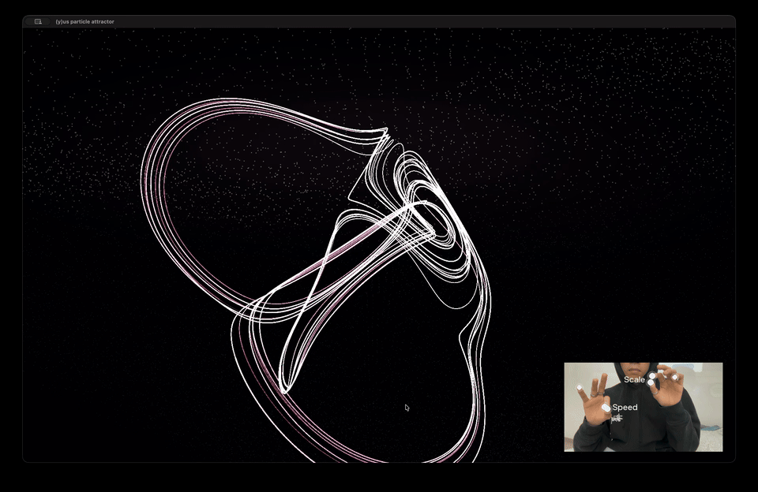

# attractormediapipe

Interactive strange-attractor performance tool built with `pygame`, `moderngl`, `numba`, `datashader`, `opencv-python`, and `mediapipe`.

The app renders one attractor at a time as a glowing particle trail, lets you steer the scene with hand gestures or traditional controls, and exports high-resolution wallpaper snapshots with preset-based styling and embedded metadata.



## How it works

The app runs three parts together:

1. A live simulation loop that advances one of nine chaotic systems in real time.
2. A ModernGL renderer that draws the newest portion of the trail as additive point sprites over a procedural atmosphere.
3. A camera and gesture layer that maps hand motion to camera rotation, speed, luminosity, fog, zoom, attractor switching and trail reset.

Pressing `S`, or running with `--snapshot-only`, exports a snapshot through Datashader: it generates millions of points, rasterizes them at wallpaper resolution, writes a clean and a textured PNG with text metadata, and appends a line to `assets/snapshot_log.jsonl`.

## Attractors

Nine attractors are included:

- Lorenz
- Aizawa
- Sprott B
- Thomas
- Dadras
- Chen
- Langford
- Rossler
- Halvorsen

Each attractor exposes:

- A Numba-compiled RK4 stepper for CPU fallback and snapshot generation.
- A parameter dictionary for HUD display, preset metadata, and controlled randomization.
- A GLSL-compatible parameter layout so the live renderer can use a GPU transform-feedback stepper when the active OpenGL context supports it.

## Live rendering

The live view draws points, with no meshes:

- The trail is stored as a ring buffer of 3D points.
- The newest `100,000` points are normalized and drawn as additive point sprites.
- Age-based fading is applied in the fragment shader instead of by mutating per-point alpha on the CPU.
- A procedural background texture and separate fog veil keep the scene readable without flattening the attractor.
- Attractor switches cut directly to the newly selected system.
- The simulation steps on the GPU through transform feedback when the OpenGL context supports it. If that fails, it falls back to the Numba CPU stepper, so older graphics hardware still works.
- Each attractor's trail buffer holds those same `100,000` points, so switching attractors refills it in a few milliseconds.

## Snapshot export

A snapshot regenerates the attractor from the simulation instead of saving the live framebuffer, so it can be much denser than the live view.

- It generates `5,000,000` points by default.
- It defaults to `5120x2880`.
- Datashader accumulates the points into a 2D density image.
- It produces two files for every export:
  - `*_clean.png`
  - `*_textured.png`

The clean image is the direct preset-based density render. The textured image applies a preset-specific surface treatment:

| Preset | Palette | Texture treatment | Background | Mood |
| --- | --- | --- | --- | --- |
| `nebula` | warm fire-like gradient | grain + scanlines | near-black | cinematic / warm |
| `blueprint` | monochrome blue range | none | deep navy | technical |
| `void` | viridis-inspired range | vignette | pure black | minimal |
| `print` | greyscale | halftone | white | printable |

Each PNG includes these text metadata fields:

- `Attractor`
- `Preset`
- `Parameters`
- `Points`
- `Resolution`
- `Timestamp`
- `Generator`

Each export also appends a JSON object with the same information plus file paths to `assets/snapshot_log.jsonl`.

## Features

- Real-time rendering of nine strange attractors.
- MediaPipe hand tracking, with different controls for the left and right hand.
- Gesture-driven pinky touch actions for reset and attractor switching.
- Smooth interpolation for speed, luminosity, fog, and zoom changes.
- Ghost mode for freezing the trail while still orbiting the camera.
- Focus mode with a slim performance bar for stage-friendly operation.
- Snapshot preset cycling in the live viewer.
- Headless and snapshot-only export support.
- GPU trail stepping path with CPU fallback.
- Unit tests for controls, snapshots, renderer state and GPU/CPU stepper equivalence.

## Installation

Install the pinned dependency set:

```bash
python3 -m pip install -r requirements.txt
```

### What each dependency does

- `pygame`: window creation, input handling, and the app loop.
- `moderngl`: OpenGL context and shader management.
- `numba`: JIT acceleration for attractor stepping and sampling.
- `opencv-python`: camera capture.
- `mediapipe`: hand landmark detection.
- `datashader` + `pandas`: high-resolution snapshot rasterization.
- `Pillow`: HUD composition, image output, and PNG metadata writing.

The UI fonts are bundled in `assets/fonts`, so no system font setup is needed.

## Running the app

Start the interactive viewer:

```bash
python3 main.py
```

Run without camera input:

```bash
python3 main.py --no-camera
```

Run in demo mode, which also disables the camera path:

```bash
python3 main.py --demo
```

Open on a specific camera index:

```bash
python3 main.py --camera-index 1
```

Exit after a fixed number of frames (handy for a quick smoke test):

```bash
python3 main.py --frames 300
```

## Snapshots and headless use

Export a snapshot and exit:

```bash
python3 main.py --snapshot-only --attractor Lorenz --preset blueprint --screenshot-path screenshot/lorenz_blueprint.png
```

Export with a larger wallpaper resolution:

```bash
python3 main.py --snapshot-only --attractor Lorenz --snapshot-width 7680 --snapshot-height 4320 --preset nebula --snapshot-fit contain --screenshot-path screenshot/lorenz_8k.png
```

Headless export uses the same snapshot renderer:

```bash
python3 main.py --headless --attractor Chen --preset void --screenshot-path screenshot/chen_void.png
```

### Snapshot notes

- `--headless` currently requires `--snapshot-only` or `--screenshot-path`.
- Invalid preset names exit cleanly and print the valid preset list.
- `--snapshot-fit cover` fills the frame and may crop; `--snapshot-fit contain` keeps the full attractor visible with margin.
- Snapshot filenames default to the `screenshot/` directory with a timestamped base name.
- With `--screenshot-path`, the `_clean` and `_textured` suffixes are still added.

## CLI reference

| Flag | Meaning |
| --- | --- |
| `--no-camera` | Disable webcam hand tracking. |
| `--demo` | Force a no-camera demo run. |
| `--camera-index` | Choose a specific webcam; `-1` scans a small range automatically. |
| `--headless` | Run without opening a window. |
| `--frames` | Exit after a fixed number of rendered frames. |
| `--screenshot-path` | Base output path for snapshot export. |
| `--snapshot-only` | Export once and exit. |
| `--attractor` | Select the startup or export attractor by name. |
| `--snapshot-width` | Override snapshot width. |
| `--snapshot-height` | Override snapshot height. |
| `--snapshot-samples` | Override Datashader point count. |
| `--snapshot-burn-in` | Override burn-in steps before sampling. |
| `--snapshot-stride` | Override sample stride. |
| `--snapshot-fit` | Choose `cover` to fill the frame or `contain` to keep the full attractor visible. |
| `--preset` | Select one of `nebula`, `blueprint`, `void`, or `print`. |

## Controls

### Webcam gestures

| Gesture | Result |
| --- | --- |
| Left thumb + index pinch | Change simulation speed |
| Left thumb + ring pinch | Change luminosity |
| Left pinky touch on palm | Reset the current trail |
| Right palm X | Yaw |
| Right palm Y | Pitch |
| Right thumb + index pinch | Zoom / scale |
| Right thumb + ring pinch | Fog |
| Right pinky touch on palm | Next attractor |

### Keyboard and mouse

| Input | Result |
| --- | --- |
| `ESC` | Quit |
| `SPACE` | Pause / resume, or exit ghost mode |
| `R` | Restart the current trail |
| `S` | Export a snapshot using the active preset |
| `P` | Cycle snapshot presets |
| `G` | Toggle ghost mode |
| `H` | Show / hide the shortcuts panel |
| `C` | Show / hide the camera feed |
| `M` | Toggle focus mode |
| `1` to `9` | Switch directly to an attractor |
| `LEFT` / `RIGHT` | Adjust yaw |
| `UP` / `DOWN` | Adjust pitch |
| `+` / `-` | Adjust speed |
| `,` / `.` | Adjust fog |
| Mouse wheel | Zoom |
| Drag slider tracks | Adjust speed, fog, luminosity, or scale from the HUD |

## Live performance notes

- Parameter changes are smoothed over `12` frames instead of snapping immediately.
- Ghost mode freezes trail growth but keeps camera movement live, so you can orbit a fixed form.
- Focus mode removes most chrome and shows a slim bottom bar with attractor name, preset, fps, and `GHOST` status.
- Attractor changes take effect immediately.
- The live view doesn't preview presets. Pressing `P` changes the preset used by the next export, and the status area shows its name.

## HUD layout


- Top-left: current attractor position.
- Top-center: title lockup.
- Top-right: attractor navigator.
- Mid-left: shortcuts panel.
- Mid-right: parameter controls.
- Bottom-left: study placard.
- Bottom-center: fps and state summary.
- Bottom-right: picture-in-picture camera panel.

The picture-in-picture camera panel stays on screen even when the camera feed is hidden. With a camera active, it shows the feed with gesture overlays and short captions next to the active controls.

## Project structure

```text
.
├── attractors/         # one file per attractor + shared manager/base classes
├── assets/             # fonts, hand-tracking model, demo media, export log
├── hands/              # tracker, gesture logic, skeleton drawing
├── renderer/           # scene renderer, GPU stepper, snapshot export helpers
├── screenshot/         # snapshot preset definitions
├── tests/              # unittest regression suite
├── config.py           # global tunables and ranges
├── main.py             # application entry point and event loop
└── requirements.txt    # pinned dependency set
```

## Development notes

The GPU stepper cuts per-frame Python overhead in the live view. The CPU stepper stays as the fallback, generates snapshot points, and gives the tests a deterministic reference to compare the GPU output against.

## Testing

Run the tests:

```bash
python3 -m unittest discover -s tests -v
```

They cover attractor stability, gesture timing and mappings, snapshot output and metadata, renderer state, and GPU/CPU stepper equivalence. GPU tests skip themselves on machines that can't create a standalone OpenGL context.

## Troubleshooting

### No camera available

Use:

```bash
python3 main.py --no-camera
```

The rest of the app still works with keyboard and mouse.

### Snapshot preset error

If `--preset` uses an unknown name, rerun with one of:

- `nebula`
- `blueprint`
- `void`
- `print`

### Slow first snapshot import

The first export is slower while Datashader and Numba compile and cache. The exporter sets `NUMBA_CACHE_DIR` and `MPLCONFIGDIR` to temp folders, in case the default cache folders aren't writable.
